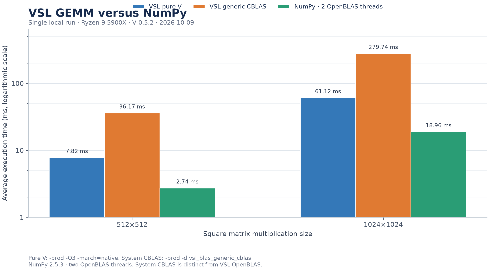

# VSL vs NumPy baselines

Run V commands from `~/.vmodules`, outside the VSL checkout. Compile production
benchmarks with `-prod`, then execute the resulting binary separately so
compiler time is excluded; do not use `v run` for measurements. `-prod` enables
V's production optimizations. Add `-cflags "-march=native"` only for local,
CPU-specific results, and record the compiler and target flags.

VSL is best compared per scientific task: BLAS/LAPACK/FFTW or GSL for
numerical kernels, SciPy for scientific routines, and scikit-learn for
like-for-like estimator tasks. NumPy is useful as an array-operation baseline,
but is not a whole-library proxy for VSL. Match algorithms, inputs, precision,
threading, and backend, and name the backend in every result.

```bash
cd ~/.vmodules
systemd-run --user --scope -p MemoryMax=4G -p MemorySwapMax=0 -- env VJOBS=2 \
	v -prod -o /tmp/vsl-matmul-bench ./vsl/benchmarks/vs_numpy/matmul_bench.v
systemd-run --user --scope -p MemoryMax=1G -p MemorySwapMax=0 -- env VJOBS=2 /tmp/vsl-matmul-bench
systemd-run --user --scope -p MemoryMax=4G -p MemorySwapMax=0 -- env VJOBS=2 \
	v -no-parallel -cc gcc -prod -cflags "-march=native" \
	-o /tmp/vsl-gemv-bench ./vsl/benchmarks/vs_numpy/gemv_bench.v
systemd-run --user --scope -p MemoryMax=1G -p MemorySwapMax=0 -- env VJOBS=2 /tmp/vsl-gemv-bench
systemd-run --user --scope -p MemoryMax=4G -p MemorySwapMax=0 -- env VJOBS=2 \
	v -prod -o /tmp/vsl-conv2d-bench ./vsl/benchmarks/vs_numpy/conv2d_bench.v
systemd-run --user --scope -p MemoryMax=1G -p MemorySwapMax=0 -- env VJOBS=2 /tmp/vsl-conv2d-bench
```

For a local build that targets the current CPU's instruction set, add
`-cflags "-march=native"` to the V command. The resulting executable is tied
to that CPU family; omit this flag for portable binaries. For example:

```bash
cd ~/.vmodules
systemd-run --user --scope --quiet -p MemoryMax=768M -p MemorySwapMax=0 -- env VJOBS=2 \
	v -prod -cflags "-march=native" -o /tmp/vsl-matmul-native ./vsl/benchmarks/vs_numpy/matmul_bench.v
systemd-run --user --scope -p MemoryMax=1G -p MemorySwapMax=0 -- env VJOBS=2 /tmp/vsl-matmul-native
```

With OpenBLAS (recommended):

```bash
cd ~/.vmodules
systemd-run --user --scope --quiet --property=MemoryMax=768M --property=MemorySwapMax=0 \
	-- env VJOBS=2 v -d vsl_blas_cblas -prod -o /tmp/vsl-matmul-openblas \
	./vsl/benchmarks/vs_numpy/matmul_bench.v
systemd-run --user --scope -p MemoryMax=1G -p MemorySwapMax=0 -- env VJOBS=2 /tmp/vsl-matmul-openblas
```

On Linux systems that provide `libcblas` but not OpenBLAS, the dense f64 GEMM
benchmark can use the system CBLAS entry point while the other BLAS routines
remain pure V:

```bash
cd ~/.vmodules
systemd-run --user --scope --quiet --property=MemoryMax=768M --property=MemorySwapMax=0 \
	-- env VJOBS=2 v -d vsl_blas_generic_cblas -prod -o /tmp/vsl-matmul-cblas \
	./vsl/benchmarks/vs_numpy/matmul_bench.v
systemd-run --user --scope -p MemoryMax=1G -p MemorySwapMax=0 -- env VJOBS=2 /tmp/vsl-matmul-cblas
```

## NumPy reference (`numpy_baseline.py`)

```bash
cd ~/.vmodules
systemd-run --user --scope --quiet --property=MemoryMax=768M --property=MemorySwapMax=0 \
	-- env VJOBS=2 OPENBLAS_NUM_THREADS=2 uv run --with numpy python \
	./vsl/benchmarks/vs_numpy/numpy_baseline.py matmul
systemd-run --user --scope --quiet --property=MemoryMax=2G --property=MemorySwapMax=0 \
	-- env VJOBS=2 OPENBLAS_NUM_THREADS=2 uv run --offline --no-project --with numpy python \
	./vsl/benchmarks/vs_numpy/numpy_baseline.py gemv
systemd-run --user --scope --quiet --property=MemoryMax=2G --property=MemorySwapMax=0 \
	-- env VJOBS=2 uv run --offline --no-project --with numpy python \
	./vsl/benchmarks/vs_numpy/numpy_baseline.py conv2d
```

The GEMV pair uses identical deterministic `f64` matrices and vectors, two
warmups, seven timed calls, and a preallocated output on both sides. It uses a
monotonic nanosecond clock and reports an index-weighted output checksum. The
V executable exercises VSL's pure-V GEMV; NumPy uses the installed NumPy BLAS
with two OpenBLAS threads. These are default-backend measurements, not a
backend-matched comparison.

On an AMD Ryzen 9 5900X with V 0.5.2 `a60fb58`, GCC 16.2.1, and NumPy 2.5.4,
three interleaved process runs on 2026-10-11 produced these median
per-process means. The V binary used `-prod -cflags "-march=native"` and the
pure-V GEMV path; the NumPy baseline used two OpenBLAS threads.

| Shape | VSL pure V (ms) | NumPy, 2 OpenBLAS threads (ms) | Faster result |
|---:|---:|---:|---:|
| 128×128 | 0.003013 | 0.002244 | NumPy 1.34× |
| 256×256 | 0.011343 | 0.006083 | NumPy 1.86× |
| 512×512 | 0.039411 | 0.027869 | NumPy 1.41× |
| 1024×1024 | 0.165433 | 0.108182 | NumPy 1.53× |

The weighted checksums agree to floating-point rounding. The f64 unit-stride
dot now uses four independent scalar accumulators; in the local Level 1
benchmark it measured 0.176 ms versus 0.233 ms for the previous SIMD path
(1.32× faster), with matching checksums. Against a sequential scalar loop it
measured 0.176 ms versus 0.170 ms, so this result does not show a win over the
simple scalar baseline. In GEMV, the VSL 1024×1024 median improved from
0.22020 ms to 0.165433 ms (1.33×), while NumPy measured 0.108182 ms. The
results remain host- and load-specific. This corrected protocol replaces the
earlier GEMV numbers, whose millisecond-resolution V timer and random NumPy
inputs did not support a reliable comparison.

The Conv2D reference uses NumPy's `sliding_window_view` and optimized
`einsum`, with deterministic inputs identical to the V benchmark, two warmups,
five timed calls, and a checksum. Compare its result with the V output to check
both timing and numerical agreement. Compare GFLOPS / ms from the GEMM and GEMV
V scripts with the Python output for the same sizes.

The current `matmul_bench.v` measures the public `Matrix * Matrix` operator,
including allocation of its result matrix, matching NumPy's allocating `a @ b`
call. On an AMD Ryzen 9 5900X with V 0.5.2, the pure-V optimized build
(`VJOBS=2`, `-prod -cflags "-O3 -march=native"`) measured 8.75 ms at 512×512
and 61.19 ms at 1024×1024 in the latest run. The NumPy 2.5.3 reference with
two OpenBLAS threads measured 2.10 ms and 17.34 ms. On this host, the pure-V
operator remains about 4.2× and 3.5× slower respectively. The optional
OpenBLAS backend is required for a faster CPU path; backend and host differences
make these local measurements unsuitable as a universal ranking.

The pure-V row-major f64 GEMM default tile was increased from 64 to 128 after
repeated local runs on the same host. With the native production build above,
two 128-tile runs measured 61.80 ms and 61.19 ms at 1024×1024; the 64-tile
reference runs measured 66.86 ms and 69.78 ms. The two-run averages were 61.50
ms and 68.32 ms respectively (about 10% faster). This tuning does not close
the remaining gap to NumPy or replace a tuned BLAS backend; confirm it on
other CPUs before treating it as generally faster.

## f32 SGEMM backend comparison

The dedicated SGEMM pair uses identical deterministic `f32` matrices, three
warmups, seven timed calls, and preallocated output buffers. The V benchmark
prints the selected implementation (`pure-V SIMD`, `CBLAS`, or `generic
CBLAS`) so the result cannot be mistaken for a different backend. Run from
`~/.vmodules`:

```bash
systemd-run --user --scope --quiet -p MemoryMax=768M -p MemorySwapMax=0 -- env VJOBS=2 \
	v -prod -o /tmp/vsl-sgemm-f32 ./vsl/benchmarks/sgemm_f32_bench.v
systemd-run --user --scope -p MemoryMax=1G -p MemorySwapMax=0 -- env VJOBS=2 /tmp/vsl-sgemm-f32
systemd-run --user --scope --quiet -p MemoryMax=768M -p MemorySwapMax=0 -- env VJOBS=2 OPENBLAS_NUM_THREADS=2 \
	uv run --with numpy python ./vsl/benchmarks/vs_numpy/numpy_sgemm_f32_baseline.py
```

On an AMD Ryzen 9 5900X with V 0.5.2 (`a60fb58`), GCC 16.2.1, and NumPy 2.5.4
using SciPy OpenBLAS 0.3.34.106.0, three interleaved process runs measured the
following median of per-process means. Each process used three warmups and
seven timed calls with the same deterministic inputs and preallocated output.
The V runs used `VJOBS=2`; NumPy used two OpenBLAS threads.

| Backend | 512×512 mean |
|---|---:|
| VSL pure-V SIMD, `-prod -march=native` | 2.797 ms |
| VSL generic system CBLAS (`blas`/`cblas` 3.12.1) | 34.511 ms |
| NumPy 2.5.4, SciPy OpenBLAS 0.3.34.106.0 | 0.972 ms |

NumPy was 2.88× faster than VSL's pure-V SIMD path in this sample. The generic
system CBLAS build was much slower than either path, while the separately
measured OpenBLAS backend in the local sample below was faster than NumPy. This
shows why results must identify the concrete BLAS provider; selecting a CBLAS
API alone does not guarantee an optimized implementation. Checksums were
`125.054512` for VSL pure-V and `125.054504` for NumPy and generic CBLAS; the
small difference is consistent with `f32` accumulation rounding. These results
describe this host, backend, and workload only. Earlier local timings in this
section are superseded: the V benchmark then allocated its output inside the
timed region while NumPy reused a preallocated output, so those numbers were
not directly comparable.

### Paired follow-up (2026-10-12)

Three interleaved process pairs on the same Ryzen 9 5900X measured median means
of 2.735 ms for VSL pure-V SIMD and 0.969 ms for NumPy 2.5.4 with two OpenBLAS
threads at 512×512. NumPy was 2.82× faster in this sample. The checksums were
`125.054512` and `125.054504`, respectively. V was built from `~/.vmodules`
with V 0.5.2 (`02cf4bd`), GCC 16.2.1, `VJOBS=2`, `-no-parallel`, `-prod`, and
`-cflags "-O3 -march=native"`; each build and process ran under a 2 GiB
`MemoryMax` with swap disabled. NumPy used the same deterministic inputs,
`OPENBLAS_NUM_THREADS=2`, and the same process-level memory cap. This confirms
the earlier gap on this host; it does not establish a cross-machine ranking.

## Ryzen 9 5900X local sample

The VSL and NumPy scripts use the same deterministic matrices, two warmups, and
five timed calls. One local run with `VJOBS=2` measured:

| Backend | 512×512 | 1024×1024 |
|---|---:|---:|
| VSL pure V, portable target | 12.00 ms | 81.46 ms |
| VSL pure V, `-march=native` | 9.16 ms | 67.73 ms |
| VSL + OpenBLAS 0.3.34 | 1.43 ms | 8.47 ms |
| NumPy 2.5.3, 2 OpenBLAS threads | 2.12 ms | 17.50 ms |

The `-march=native` pure-V build was about 4.3× slower than NumPy at 512×512
and 3.9× slower at 1024×1024 in this run. The OpenBLAS builds differ: VSL
linked to the official Arch OpenBLAS 0.3.34 package, while NumPy used its
wheel-provided BLAS. The OpenBLAS package used for this local VSL run was
signature verified and extracted temporarily rather than installed
system-wide. Rerun these commands on the target host before drawing a general
performance conclusion.

### Updated local sample (2026-10-09)

A fresh run on the same Ryzen 9 5900X host used V 0.5.2, the production build
with `-O3 -march=native`, two warmups, and five timed calls. NumPy 2.5.3 used
two OpenBLAS threads and the same deterministic input values:

| Backend | 512×512 | 1024×1024 |
|---|---:|---:|
| VSL pure V, production + native CPU flags | 7.82 ms (34.34 GFLOPS) | 61.12 ms (35.14 GFLOPS) |
| VSL generic system CBLAS, production | 36.17 ms (7.42 GFLOPS) | 279.74 ms (7.68 GFLOPS) |
| NumPy, 2 OpenBLAS threads | 2.74 ms (97.92 GFLOPS) | 18.96 ms (113.24 GFLOPS) |

In this run, pure V was 2.85× slower at 512×512 and 3.22× slower at
1024×1024. The generic system CBLAS build was 13.20× and 14.75× slower than
NumPy respectively, and slower than the pure-V kernel at both sizes. This
host's generic CBLAS is not an optimized BLAS backend; installing or linking
an arbitrary CBLAS library does not guarantee a faster VSL path. The V
measurements ran with `VJOBS=2` under a 1536 MiB
`MemoryMax`; NumPy ran with `VJOBS=2`, `OPENBLAS_NUM_THREADS=2`, and a 768 MiB
`MemoryMax`. The system did not have OpenBLAS installed, so this run measures
VSL's pure-V and generic system CBLAS paths plus NumPy's wheel-provided
OpenBLAS; it says nothing about VSL's optional OpenBLAS backend. Results are
host-specific. Reproduce the V runs from `~/.vmodules` with:



Vector version: [SVG](gemm-comparison-2026-10-09.svg). Regenerate both formats
from `~/.vmodules` with:

```bash
systemd-run --user --scope --quiet -p MemoryMax=768M -p MemorySwapMax=0 -- env VJOBS=2 \
	uv run --with matplotlib python ./vsl/benchmarks/vs_numpy/plot_gemm_comparison.py
```

The plot records this host-specific sample; do not generalize it to other CPUs.

```bash
systemd-run --user --scope --quiet -p MemoryMax=1536M -p MemorySwapMax=0 -- env VJOBS=2 \
	v -prod -cflags "-march=native" -o /tmp/vsl-matmul-native ./vsl/benchmarks/vs_numpy/matmul_bench.v
systemd-run --user --scope -p MemoryMax=1536M -p MemorySwapMax=0 -- env VJOBS=2 /tmp/vsl-matmul-native
systemd-run --user --scope --quiet -p MemoryMax=1536M -p MemorySwapMax=0 -- env VJOBS=2 \
	v -prod -d vsl_blas_generic_cblas -o /tmp/vsl-matmul-cblas ./vsl/benchmarks/vs_numpy/matmul_bench.v
systemd-run --user --scope -p MemoryMax=1536M -p MemorySwapMax=0 -- env VJOBS=2 /tmp/vsl-matmul-cblas
systemd-run --user --scope --quiet -p MemoryMax=768M -p MemorySwapMax=0 -- env VJOBS=2 OPENBLAS_NUM_THREADS=2 \
	uv run --with numpy python ./vsl/benchmarks/vs_numpy/numpy_baseline.py matmul
```

## Output and reporting

Use the same host, flags, and matrix sizes for both VSL and NumPy. A useful
release note includes:

| Field | Example |
|-------|---------|
| CPU/GPU | `Ryzen 9`, `RTX 4060 Laptop` |
| V flags | `-d vsl_blas_cblas`, `-d cuda`, `-d vulkan` |
| Operation | `matmul`, `gemv`, `conv2d` |
| Size | `512`, `1024`, or Conv2D shape |
| Result | `ms`, `GFLOPS`, ratio vs baseline |

CUDA/Vulkan benchmark variants should be treated as opt-in until dedicated CI
coverage is added. Prefer scoped smoke tests for PR validation.

## Priority sizes

| Op | Shape |
|----|-------|
| GEMM | 128, 256, 512, 1024 |
| GEMV | square `m=n` same sizes |
| Conv2D | `1×1×32×32`, kernel `3×3`, stride 1 |

Tracked in [issue #282](https://github.com/vlang/vsl/issues/282).
